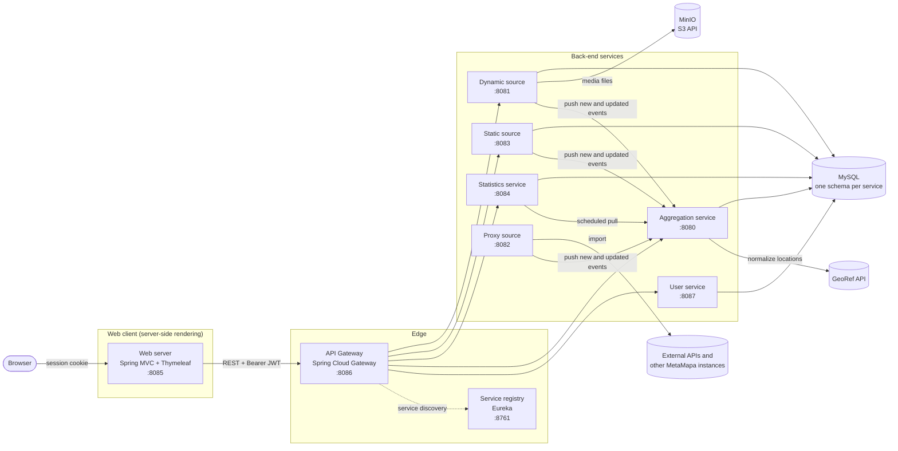
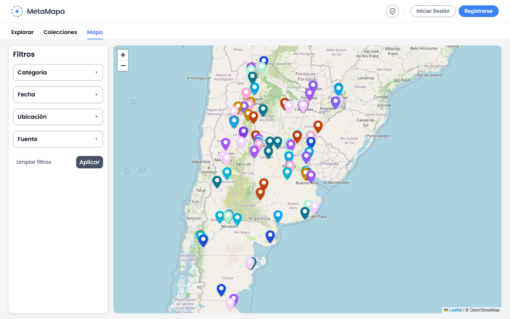
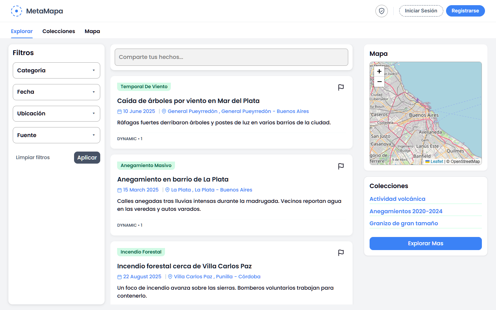

# MetaMapa

**A decentralized, geo-referenced platform for collaborative mapping of events** such as natural disasters, fires or protests. Each institution (an NGO, a university, a government agency) hosts its own instance and combines data from static datasets, citizen contributions and external APIs, including other MetaMapa instances.

Year-long team project for the *Information Systems Design* course at UTN FRBA (Universidad Tecnológica Nacional, Buenos Aires), March 2025 – February 2026. **Approved with honors.**

## Architecture



- The **web client** never talks to the services directly: every call goes through the **API Gateway**, which verifies the JWT, checks the roles declared for the route and forwards the request to the right service, resolved through Eureka.
- **Sources push data** to the aggregator. The aggregator subscribes to each source once; from then on the source notifies it of new and updated events, so nothing is polled.
- Each service owns its own database schema; the proxy source keeps its state in memory.

More detail in [docs/architecture.md](docs/architecture.md).

## Features

- **Three kinds of sources**
  - *Static*: admins upload CSV datasets, which are imported by a scheduled job. Sample datasets are included in the repository.
  - *Dynamic*: citizens submit events, anonymously or registered, with images and videos. Admins review every submission, and registered authors can request edits for 7 days.
  - *Proxy*: imports from the course's natural-disasters API (pages fetched in parallel) and from other MetaMapa instances.
- **Aggregation**: collections defined by membership criteria (title, category, date range), filters and pagination, curated navigation backed by three consensus algorithms re-evaluated every night, and deletion requests with automatic spam rejection.
- **Location normalization**: coordinates are turned into province, department and municipality through Argentina's GeoRef API, in parallel batches of up to 1,000 points, with deduplicated persistence.
- **Security**: RS256-signed JWTs, BCrypt password hashing, role rules declared per route in the gateway configuration, and user-identity headers that only the gateway can set.
- **Statistics**: top categories, top provinces by category or collection, and busiest hours by category, recomputed on a schedule from aggregator data.
- **Multimedia**: files stored in MinIO through the S3 API, restricted by a MIME-type whitelist and a maximum number of files per event, and served through the gateway.

## Tech stack

Java 17 · Spring Boot 3.4 · Spring Cloud 2024.0 (Gateway, Netflix Eureka) · Spring Data JPA / Hibernate · MySQL 8 · Spring Security · jjwt (RS256) · Spring WebClient · AWS SDK v2 + MinIO · Thymeleaf + Bootstrap · Maven (multi-module, wrapper included) · Postman / Newman

## Quick start

There is no Docker setup on `main`; every service runs as a regular Spring Boot application.

**Requirements:** JDK 17+, MySQL 8 on `localhost:3306` and MinIO on `localhost:9000` with a bucket named `metamapa-media`. Maven is not needed because the Maven wrapper is included.

1. In every service, copy `src/main/resources/application.properties.example` to `application.properties` and fill in the `<PLACEHOLDERS>`: database user and password, the RS256 key pair, MinIO keys and the credentials for the course API. The databases are created on startup.
2. Start the services in this order (from `backend/<service>`, run `../mvnw spring-boot:run`):
   1. `server-registry`
   2. `user-service`, `static-source`, `dynamic-source`, `proxy-source`, `aggregation-service`, `statistics-service`
   3. `api-gateway`
   4. the web client (`frontend/`, run `./mvnw spring-boot:run`)
3. Register the sources in the aggregator (`POST /source-clients`) to start the data flow. The `Seed` collection in [`postman/`](postman/) does it.
4. Open <http://localhost:8085>.

| Service | Port | | Service | Port |
|---|---|---|---|---|
| server-registry (Eureka) | 8761 | | dynamic-source | 8081 |
| api-gateway | 8086 | | proxy-source | 8082 |
| user-service | 8087 | | static-source | 8083 |
| aggregation-service | 8080 | | statistics-service | 8084 |
| web client | 8085 | | MinIO / MySQL | 9000 / 3306 |

Step-by-step guide, including how to generate the JWT keys and create an admin user: [docs/running-locally.md](docs/running-locally.md).

## Screenshots

Taken from a local run with the static source's sample dataset (1,000 events, normalized through GeoRef) and a few citizen submissions. The UI is in Spanish.

| Map view with filters | Events feed with normalized locations |
|---|---|
|  |  |

More: [admin panel, moderation queue](docs/images/admin-pending.png) · [collections](docs/images/collections.png) · [landing page](docs/images/landing.png)

## Testing

The API is tested with **Postman collections organized by service and feature** (in [`postman/`](postman/)):

- **3 collections with 86 requests**: the main collection (69 requests covering every service and the gateway), a data-seeding flow (6) and an end-to-end moderation scenario for the dynamic source (11).
- **53 automated assertions** (`pm.test`):
  - *Authentication*: register, login and refresh, plus the error cases (existing username, wrong password, access token sent to the refresh endpoint).
  - *Route security*: one request per gateway rule with the expected `200`, `401` or `403`, including a missing, malformed or refresh token and the wrong role, and a regression test that forged `X-User-Id` headers never reach a service.
  - *Moderation*: every step of the dynamic-source scenario, from submission to approved edit.
- One environment file holds every base URL. Login and register store the returned tokens, and protected requests reuse them as `Bearer {{AccessToken}}`.
- The other folders are checked by hand. There is no CI pipeline.
- **Last run (2026-11-24, local stack, Newman):** gateway folder 19 requests and **36/36 assertions**; moderation scenario 11 requests and **17/17 assertions**.

To run the gateway security tests from the command line:

```bash
npx newman run postman/MetaMapa.postman_collection.json -e postman/MetaMapa.local.postman_environment.example.json --folder "API Gateway"
```

Details, coverage and how to run the collections in Postman's Collection Runner: [docs/testing.md](docs/testing.md).

## My contributions

A fellow teammate and I were the two main contributors, with 86% of the ~1,050 commits between us. My work, from biggest to smallest:

- **Authentication and route security, designed and built by me alone.** It combines sessions and tokens: the browser only holds a session cookie, while the web server keeps the JWTs and sends them to the gateway. A separate [user service](backend/user-service/) issues RS256 access and refresh tokens. The gateway verifies every token with the public key ([`AuthenticationFilter`](backend/api-gateway/src/main/java/ar/utn/edu/frba/ddsi/filters/AuthenticationFilter.java)), and the web server renews expired tokens transparently and retries the call ([`WebApiCallerService`](frontend/src/main/java/interfaz/grafica/ddsi/services/internal/WebApiCallerService.java)). I also built a small declarative syntax for route rules, so protecting a new endpoint takes one line in [`routes.yml`](backend/api-gateway/src/main/resources/routes.yml): `AuthenticationFilter=ADMIN`, a roles list for OR, stacked filters for AND, and `required: false` for optional authentication. In the web client, I protected the admin panel by role, in its routes and in its page components, and added the error pages. Submissions, deletion requests and their reviews store the user's public UUID taken from the gateway headers, so every moderation action can be traced to a user.
- **API Gateway, service registry and integration.** I proposed and built the [API Gateway](backend/api-gateway/) (Spring Cloud Gateway) and the [Eureka registry](backend/server-registry/) to connect the front end with the back end and to secure and route requests. I also connected the server-rendered web client to the back end through the gateway ([`ServerAdapter`](frontend/src/main/java/interfaz/grafica/ddsi/models/entitites/adapters/ServerAdapter.java)).
- **Push integration between sources and the aggregator.** In the static, dynamic and proxy sources, I built the source side of the push-based integration: a subscription endpoint (webhook) and an Observer-based publisher that notifies every subscribed aggregator of new and updated events ([`Publisher`](backend/static-source/src/main/java/ar/utn/edu/frba/ddsi/models/entities/observer/Publisher.java)).
- **Proxy source.** I built the [proxy source](backend/proxy-source/): adapters for the course's natural-disasters API (login, then parallel paginated import) and for other MetaMapa instances.
- **Aggregator, core parts.** Persistence of collections and their criteria ([`CollectionCriteriaService`](backend/aggregation-service/src/main/java/ar/utn/edu/frba/ddsi/services/impl/CollectionCriteriaService.java)), provinces and pagination endpoints, and media URL generation.
- **Location normalization.** [`NormalizationService`](backend/aggregation-service/src/main/java/ar/utn/edu/frba/ddsi/services/impl/NormalizationService.java), [`LocationService`](backend/aggregation-service/src/main/java/ar/utn/edu/frba/ddsi/services/impl/LocationService.java) and the GeoRef adapter [`LocationAPI`](backend/aggregation-service/src/main/java/ar/utn/edu/frba/ddsi/models/entities/adapters/LocationAPI.java). Events that share coordinates are grouped, requests are split into batches of 1,000 and sent in parallel, and provinces, departments and municipalities are saved only once.
- **Object storage with MinIO, built by me alone.** S3-compatible storage for event media ([`S3StorageService`](backend/dynamic-source/src/main/java/ar/utn/edu/frba/ddsi/services/storage/S3StorageService.java)). If saving an event fails, the files already uploaded are deleted. Files are streamed back through the gateway, and media URLs are built by a Strategy so they can later be replaced with pre-signed URLs.
- **Media upload and gallery UI.** In the web client, the upload previews, with a limit of five files and animations ([`upload-manager.js`](frontend/src/main/resources/static/js/managers/upload-manager.js)), and a full-screen gallery with keyboard navigation, image zoom and pan, and lazy-loaded videos ([`media-gallery.js`](frontend/src/main/resources/static/js/media-gallery.js)).
- **Static source, co-developed.** Besides the push publishing, the persistence of the importer strategy ([`ImporterConverter`](backend/static-source/src/main/java/ar/utn/edu/frba/ddsi/converters/ImporterConverter.java)) and the source factory.
- **Event filters:** a teammate implemented them while I was building authentication; I helped design and debug them.
- **Testing.** After the course, I built the automated test suite on my own: 53 assertions run with Newman over the gateway and moderation flows, including a regression test for the identity-header gap I fixed ([`StripIdentityHeadersFilter`](backend/api-gateway/src/main/java/ar/utn/edu/frba/ddsi/filters/StripIdentityHeadersFilter.java)). The Postman collections it runs on were built with a teammate during the course, organized by service and feature. Earlier I wrote JUnit tests for the first static source; they became obsolete when the second delivery changed the requirements.

## Documentation

| Document | Contents |
|---|---|
| [Architecture](docs/architecture.md) | Services, responsibilities, communication (push, gateway, Eureka) |
| [Authentication](docs/authentication.md) | Token design, gateway route rules, session + JWT scheme |
| [Design decisions](docs/design-decisions.md) | Short ADRs: context, decision, alternatives, consequences |
| [Evolution](docs/evolution.md) | What each of the six deliveries asked for and what was built |
| [Running locally](docs/running-locally.md) | Configuration, keys, start-up order, seeding data |
| [Testing](docs/testing.md) | Postman collections, coverage and how to run them |

## Team

Built by a team of five at UTN FRBA. Main contributors: [@FacundoDiezF](https://github.com/FacundoDiezF) and [@valenosa](https://github.com/valenosa) (86% of the commits). Also on the team: [@mateonhernandez](https://github.com/mateonhernandez), [@Cicalalautaro](https://github.com/Cicalalautaro) and [@lDevecchi](https://github.com/lDevecchi).
