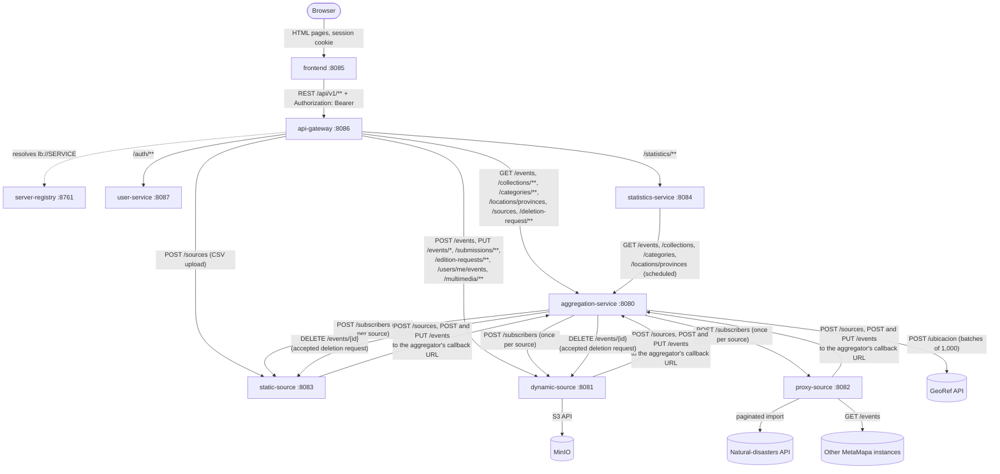
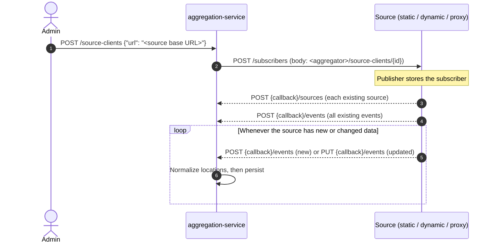

# Architecture

MetaMapa is split into independent Spring Boot services. Each one owns its data and exposes a REST API. Every client request enters through an API Gateway, and data flows from the **sources** (where events originate) to the **aggregator** (which combines them) by **push notifications**.

## Services

| Service | Port | Responsibility | Storage | In Eureka |
|---|---|---|---|---|
| `server-registry` | 8761 | Eureka server: service discovery for the gateway | – | – |
| `api-gateway` | 8086 | Single entry point: routing, JWT verification, role checks, user headers | – | yes |
| `user-service` | 8087 | Registration, login, issuing and refreshing tokens (RS256) | MySQL `metamapa_users` | yes |
| `aggregation-service` | 8080 | Combines all sources: events, collections, consensus, deletion requests, location normalization | MySQL `metamapa_aggregator` | yes |
| `static-source` | 8083 | CSV dataset upload and scheduled import | MySQL `metamapa_static` | yes |
| `dynamic-source` | 8081 | Citizen submissions, moderation, edit requests, media storage | MySQL `metamapa_dynamic` + MinIO | yes |
| `proxy-source` | 8082 | Imports from external APIs and other MetaMapa instances | in memory | no |
| `statistics-service` | 8084 | Periodic statistics over the aggregator's data | MySQL `metamapa_statistics` | yes |
| `frontend` | 8085 | Server-side rendered web client (Spring MVC + Thymeleaf) | HTTP session | no |

All the MySQL schemas can live in the same MySQL server; each service uses its own schema and nothing else. Ports and names come from the services' `application.properties.example` files.

## How the services communicate

### 1. Client requests: browser → web server → gateway → service

The browser only talks to the web server and only holds a session cookie. The web server renders pages with Thymeleaf. To get data it calls the gateway with the user's access token, which it keeps in the HTTP session ([`ServerAdapter`](../frontend/src/main/java/interfaz/grafica/ddsi/models/entitites/adapters/ServerAdapter.java), [`WebApiCallerService`](../frontend/src/main/java/interfaz/grafica/ddsi/services/internal/WebApiCallerService.java)).

The gateway matches the request against [`routes.yml`](../backend/api-gateway/src/main/resources/routes.yml) by path and method. It strips the `/api/v1` prefix, applies the route's authentication rule and forwards the request to `lb://SERVICE-NAME`, which Eureka resolves. For authenticated requests it adds `X-User-Id` and `X-User-Name` headers, so services know who the user is without parsing tokens; any copies of those headers sent by the client are removed first. The proxy source has no gateway routes: only the aggregator talks to it. See [authentication.md](authentication.md).

### 2. Data ingestion: sources push to the aggregator

The aggregator does not poll the sources. The integration is push-based and follows the Observer pattern:

When each source pushes:

- **Static:** after a scheduled job imports a newly uploaded CSV.
- **Dynamic:** when an admin accepts a submission (new event) or approves an edit request (updated event).
- **Proxy:** on a schedule, with the events imported from its APIs.

In each source a `Publisher` keeps a set of `ISubscriber`s. On the aggregator side, a [`SourceClient`](../backend/aggregation-service/src/main/java/ar/utn/edu/frba/ddsi/models/entities/source/SourceClient.java) represents each subscribed source service. Because the aggregator is just another subscriber, more than one aggregator (or MetaMapa instance) can subscribe to the same source.

Changes also flow the other way. When an admin accepts a deletion request, the aggregator marks the event as deleted and, for static and dynamic sources, calls `DELETE /events/{id}` on the source.

### 3. Statistics: scheduled pull

`statistics-service` periodically asks the aggregator only for what changed since its last run (`fromUpdatedDate`), stores a copy in its own schema and computes the statistics from it. It calls the aggregator directly through the `aggregation-service.url` property.

### 4. External systems

| From | To | Why |
|---|---|---|
| aggregation-service | GeoRef API (`apis.datos.gob.ar/georef`) | Turn coordinates into province, department and municipality |
| proxy-source | Course natural-disasters API | Import events (logs in, then fetches pages in parallel) |
| proxy-source | Other MetaMapa instances | Import their events (`GET /events`) |
| dynamic-source | MinIO, or any S3-compatible storage | Store and stream event media |

## Inside each service

Every service uses the same three layers: **controllers** receive requests and do basic validation, **services** hold the business logic, and **repositories** handle data access (Spring Data JPA, or in-memory in the proxy). DTOs separate the API contract from the entities.

| Pattern | Where |
|---|---|
| Observer | `Publisher` / `ISubscriber` in each source; push notifications to aggregators |
| Adapter | `NaturalDisastersAPI` and `MetaMapa` behind `IAPI` (proxy); `LocationAPI` for GeoRef (aggregator) |
| Strategy | `IImporter` / `CsvImporter` (static); `IConsensusAlgorithm` with three implementations (aggregator); `UrlGenerationStrategy` for media URLs; collection `Condition` types |
| Factory | `SourceFactory` (static, proxy), `UserFactory` (user-service) |
| Gateway filter factory | `AuthenticationFilter`, configured per route in YAML |

## Scheduled jobs

| Service | Job | Default schedule (`application.properties.example`) |
|---|---|---|
| static-source | Import pending CSV sources | every minute |
| proxy-source | Push new and updated events | every hour |
| aggregation-service | Refresh collections | every hour |
| aggregation-service | Re-evaluate consensus | every day at 03:00 |
| statistics-service | Pull data and recompute statistics | every 2 minutes |
