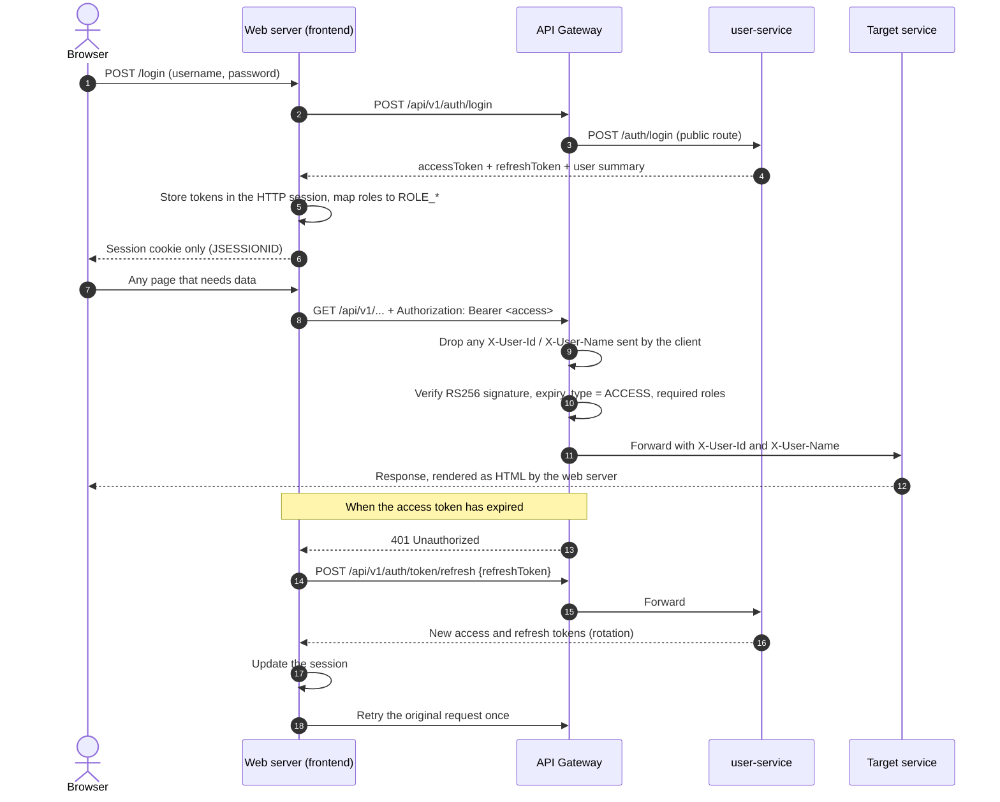

# Authentication and route security

> I designed and built this part of the system on my own: the user service, token issuing, the gateway filter and its route syntax, and the session handling in the web client.

## Goals

- **One place to verify identity.** The back-end services should not each validate tokens.
- **Stateless back end.** Any service instance can serve any request, so the services can scale horizontally.
- **Keep tokens out of the browser.** The web client is server-side rendered, so the browser should only hold a session cookie.
- **Make protecting a route trivial.** A new endpoint should be secured with one line of configuration.

## Overview

| Piece | Responsibility | Key code |
|---|---|---|
| `user-service` | Registers users (BCrypt), checks credentials, **issues** access and refresh tokens signed with the RS256 **private** key | [`AuthService`](../backend/user-service/src/main/java/ar/utn/edu/frba/ddsi/services/impl/AuthService.java), [`JwtService`](../backend/user-service/src/main/java/ar/utn/edu/frba/ddsi/services/JwtService.java) |
| `api-gateway` | **Verifies** every access token with the **public** key, enforces the roles declared for each route and passes the user's identity to the services as headers, which clients cannot forge | [`AuthenticationFilter`](../backend/api-gateway/src/main/java/ar/utn/edu/frba/ddsi/filters/AuthenticationFilter.java), [`StripIdentityHeadersFilter`](../backend/api-gateway/src/main/java/ar/utn/edu/frba/ddsi/filters/StripIdentityHeadersFilter.java), [`routes.yml`](../backend/api-gateway/src/main/resources/routes.yml) |
| `frontend` (web server) | Keeps the tokens in the user's HTTP session, sends them to the gateway and **renews** them transparently when they expire | [`CustomAuthProvider`](../frontend/src/main/java/interfaz/grafica/ddsi/providers/CustomAuthProvider.java), [`WebApiCallerService`](../frontend/src/main/java/interfaz/grafica/ddsi/services/internal/WebApiCallerService.java) |



## Tokens

| | Access token | Refresh token |
|---|---|---|
| Claims | `sub` (username), `userId` (public UUID), `roles`, `type: ACCESS` | `sub`, `type: REFRESH` |
| Lifetime | Short: `app.jwt.expiration-minutes` (5 minutes in the example configuration) | `app.jwt.refresh-expiration-minutes` (24 hours) |
| Used by | Gateway, on every protected request | `user-service`, only at `/auth/token/refresh` |

- **RS256, not HS256.** Tokens are issued in one place and verified in another. With asymmetric keys, only `user-service` holds the private key; the gateway holds the public key, which can only verify tokens, not create them, so leaking it is not a risk.
- Keys are Base64-encoded DER (PKCS#8 for the private key, X.509 for the public key) and are read from `JWT_PRIVATE_KEY` and `JWT_PUBLIC_KEY`. Environment variables take precedence over the properties file, so a deployment does not need to change the code. [running-locally.md](running-locally.md) shows how to generate a pair.
- The gateway only accepts tokens with `type: ACCESS`, so a refresh token cannot be used to call the API.
- Every refresh issues a new refresh token as well (rotation). An active user stays logged in, and an idle session eventually expires.
- **Users are referenced by a public UUID.** The other services store this `userId`, for example as the creator of an event or the reviewer of a deletion request. It acts as a logical foreign key across databases and avoids exposing internal database ids or usernames.

## Route rules: a small declarative syntax

`AuthenticationFilter` is a Spring Cloud Gateway filter factory. Each route in `routes.yml` declares who may use it:

| Configuration in `routes.yml` | Meaning |
|---|---|
| *(no filter)* | Public |
| `- AuthenticationFilter` | Any authenticated user |
| `- AuthenticationFilter=ADMIN` | The user must have the `ADMIN` role (short syntax) |
| `roles: [ADMIN, CONTRIBUTOR]` | **OR**: at least one of the roles |
| Two filters stacked: `=CONTRIBUTOR` and `=ADMIN` | **AND**: both roles |
| `required: false` (optionally with `roles`) | **Optional authentication**: anonymous requests pass; if a token is sent, it must be valid |

For example, citizens can submit events anonymously, but if they are logged in the event is linked to their account:

```yaml
- id: post-event
  uri: lb://DYNAMIC-SOURCE
  predicates:
    - Path=/api/v1/events
    - Method=POST
  filters:
    - StripPrefix=2
    - name: AuthenticationFilter
      args:
        required: false
        roles: [ADMIN, CONTRIBUTOR]
```

Responses:

- **401** when the token is missing (on a required route), invalid, expired or not an access token.
- **403** when the token is valid but has none of the required roles. The target service never sees the request.
- On success the `X-User-Id` and `X-User-Name` headers are added, so services read the user from a header instead of decoding the JWT.

### Identity headers

The services trust `X-User-Id` and `X-User-Name`, so only the gateway may set them. A global filter, [`StripIdentityHeadersFilter`](../backend/api-gateway/src/main/java/ar/utn/edu/frba/ddsi/filters/StripIdentityHeadersFilter.java), removes both headers from every incoming request before any route filter runs, and `AuthenticationFilter` adds them back only from a validated access token.

This closes a gap found after the course: on optional-authentication routes, a request without a token used to reach the service with whatever `X-User-Id` the client sent, so it could submit an event or a deletion request as another user. A Postman regression test sends forged headers and checks that they never reach the service. For the same reason, in a deployment only the gateway should be reachable from outside.

### Self-test routes

The gateway also ships with six **self-test routes** (`/api/v1/test/public`, `/authenticated`, `/admin-only`, `/admin-and-contributor`, `/admin-or-contributor`, `/soft-auth`). Each one covers one rule and is forwarded to an endpoint that echoes the received headers, which makes it easy to check, for example, that `X-User-Id` is injected. The Postman collection asserts the expected status code for each rule, including the negative cases: no token, a malformed token, a refresh token used as an access token and the wrong role ([testing.md](testing.md)).

### Rules currently in use

| Access | Routes (under `/api/v1`) |
|---|---|
| Public | `/auth/**`, `GET /events`, `GET /collections`, `GET /collections/*`, `GET /collections/*/events`, `GET /categories/**`, `GET /locations/provinces`, `GET /multimedia/**` |
| Optional authentication | `POST /events` (submit an event), `POST /deletion-request` |
| `CONTRIBUTOR` | `PUT /events/*` (request an edit of your own event), `GET /users/me/events` |
| `ADMIN` | Create, update and delete collections; `GET /sources`; `POST /sources` (CSV upload); review deletion requests, submissions and edit requests; all `/statistics/**` routes |

## Sessions and tokens together

The web client is a server-side rendered Spring MVC application, so the browser never receives a JWT:

1. Spring Security's form login calls a custom `AuthenticationProvider`, which forwards the credentials to the gateway.
2. On success, the access token, refresh token, user id and username are stored in the server-side **HTTP session**, and the roles become Spring authorities (`ROLE_ADMIN`, `ROLE_CONTRIBUTOR`). The web server uses them to protect pages and hide buttons.
3. Every back-end call goes through `WebApiCallerService`, which adds the `Authorization` header from the session. If the gateway answers 401 or 403 and a refresh token exists, it refreshes the tokens once, updates the session and retries.
4. Registering logs the user in automatically, because `user-service` returns tokens on registration as well.
5. Logging out invalidates the session and deletes the cookie.

This keeps tokens out of the browser (and out of the reach of client-side scripts), while the back end stays stateless and only ever sees short-lived tokens.

## Passwords, users and roles

- Passwords are hashed with **BCrypt** in `user-service`. They travel in plain text only inside the request, which must use HTTPS in a deployment.
- Users have an `active` flag, so an account can be disabled without deleting it. Inactive users cannot log in or refresh tokens.
- Two roles: `ADMIN` and `CONTRIBUTOR`. New accounts are created as `CONTRIBUTOR`; admins are promoted in the database (see [running-locally.md](running-locally.md)).

## Trade-offs and next steps

These were documented by the team as deliberate scope decisions:

- **Roles travel inside the token**, so the gateway never has to call `user-service`. The cost is that a role change only takes effect when the access token expires; short-lived access tokens limit that window. Possible next steps: re-check roles on sensitive routes, or keep a token blacklist (for example in Redis).
- **Refresh tokens are rotated but old ones are not invalidated yet.** Storing issued refresh tokens, or blacklisting the used ones, is the planned fix.
- **Coarse roles instead of permissions.** Two non-overlapping roles were enough for the domain and kept delivery fast. The planned evolution is role-based access control (RBAC): the gateway and web client check fine-grained permissions, and roles become sets of permissions managed in `user-service`.
